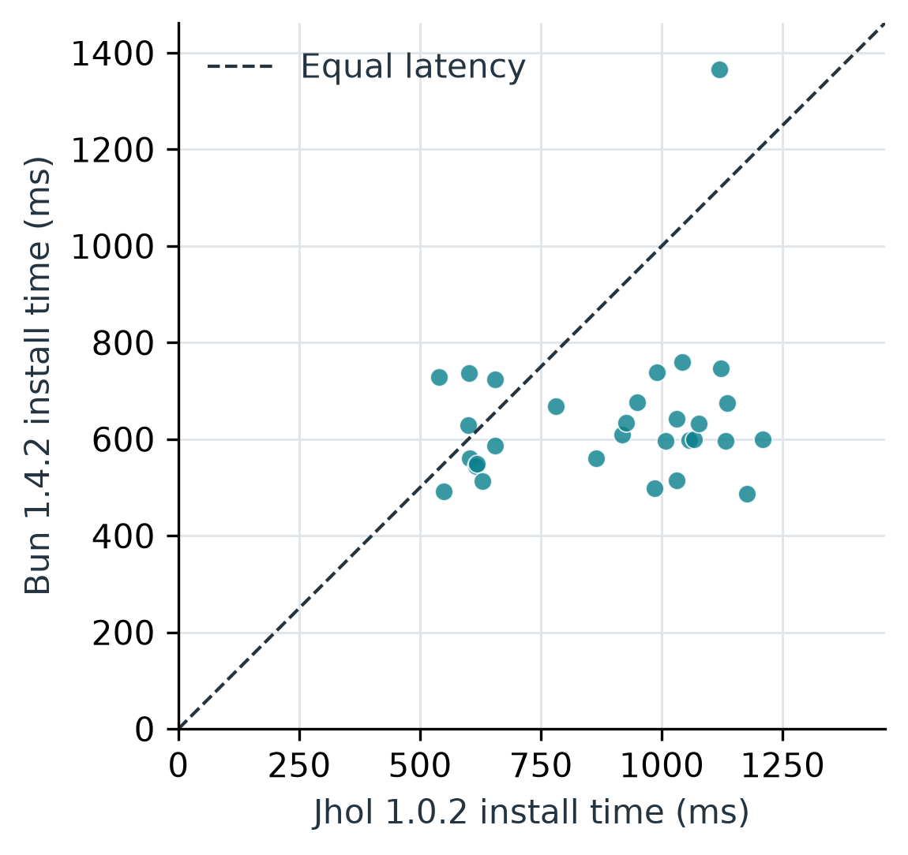

## Abstract {.unnumbered}

Dependency resolvers frequently reduce candidate sets before the transitive constraints are fully known. This study investigates when such reductions preserve the feasibility of assignments outside the eliminated region. We analyze two failures observed in Jhol on the Express 4.18.2 dependency graph and give a projection rule that preserves feasibility and additive objectives for a finite placement model. A reference implementation agrees with exhaustive enumeration on 4,096 factor systems and 16,384 exterior assignments. A separate reanalysis of 30 paired registry-cold runs reports median install times of 967.56 ms for Jhol and 605.07 ms for Bun on a locked React/Vite fixture. The field failures identify two distinct sources of unsoundness: eliminating candidates before discovering all incident requirements and merging version-dependent constraints. The finite-model result establishes a correctness criterion for future resolver reductions. The installation measurements characterize an existing deployment path.

# Introduction

I started with a practical question in Jhol: how much registry metadata can a resolver discard without changing what it can install? Express 4.18.2 exposed the problem. A version of mime that looked unnecessary early in the install became necessary when another parent entered the graph. A registry packument lists available versions, dependencies, peers, distribution tags, and publication times. A dependency discovered from one version may disappear or change range when a different version is selected. A solver that prunes a package's entire domain using the first observed parents can lose a valid solution. In an npm layout, incompatible requirements can sometimes coexist through separate installed instances. Combining all demands on a package name into one intersection can therefore invent a conflict.

This report contributes (1) a production case study of unsound candidate reduction and the checks used to contain it, (2) an exact boundary-summary model with a finite correctness argument and a counterexample to greedy selection on a tree, and (3) an evaluation protocol that separates solver cost from registry, extraction, and layout. The model uses established constraint projection. The research contribution to evaluate is its application to version-specific dependency and peer scopes, with soundness checks before any optimization decides a tree.

# Background and Related Work

PacSolve formalizes dependency resolution as constraint solving and provides MaxNPM as an implementation with configurable objectives [1]. Bounded-width CSP algorithms analyze the cost of eliminating variables through their remaining neighbors [2]. The boundary relation in Section 4 uses this established operation. This study uses it to state the evidence required before deleting version-specific package metadata. Cellular sheaf Laplacians characterize linear compatibility in a sheaf of vector spaces [3]. The discrete choice of one published package version per slot adds a restriction that the existence of a linear section does not establish.

# System and Failure Analysis

In the baseline implementation, JAGR compiles SemVer predicates, represents candidate sets with ordinal bitmaps, propagates constraints to a fixpoint, and searches with a finite budget. The production virtual machine emits seven instruction kinds. A bounded search can run out of budget, so an exhausted search is distinct from a proof of infeasibility. The chart result can replace the flat estimate only after a check of the selected versions' declared required ranges. The nested branch represents package instances and can install multiple incompatible versions. Exact pins, prereleases, optional edges, peers, aliases and overrides belong in the semantic model of an experiment, with unsupported cases explicitly reported.

The October audit and November scorecard record two different failures.

1. **Incomplete domains.** A synthesized one-version packument and filtering against constraints seen so far left the solver with only mime 1.6.0. Express 4.18.2's closure includes consumers with incompatible requirements, including 0.19.0 and ~1.2.6. The flat chart declined, and the fallback estimate was built from similarly incomplete inputs. Online resolution moved to full packuments and no longer uses the seen-so-far filter to decide a version. A former 98.2% metadata-reduction result is evidence about removed bytes. Its semantic outcome must accompany the measurement.
2. **Incorrect relations.** Even with full metadata, a flat chart candidate could select accepts 2.0.0 for Express 4.18.2, whose selected manifest declares ~1.3.8. Unioning edge masks across versions admitted a choice no selected parent justified. The declared-range gate rejected that candidate before it could replace the estimate. The final-version dependency and peer closure now shares one traversal to avoid losing a peer discovered after an earlier pass.

JAGR still computes RG, Ricci, and sheaf summaries under trace flags. The compiled production instructions do not consume those summaries. A separate lockfile continuation branch exists. Neither its presence nor the diagnostic values demonstrate exact global gluing or elimination by cohomology.

The follow-up flat chart keeps the parent releases that declare each edge. It propagates a requirement only when every remaining parent release demands that target. During search it opens dependencies from the chosen release and withdraws them on backtracking. This change preserves the distinction between an absent edge and an edge with no compatible release. The same required-closure check runs before replaying a cached selection. The separator rule below remains a reference algorithm.

# Formal Model

Let $V$ be a finite set of variables with domains $D_v$. For a bounded placement model, a variable can represent an installed slot and its domain can include an absent value. A factor on a subset of $V$ records a permitted tuple. Dependencies and peers are conditional on the selected parent version, including the instance or provider visible under the placement rule. Fix the placement model, registry snapshot and policy inputs before comparing solvers.

Choose interior variables $I$. Let $F_I$ contain every factor touching $I$ and let $S$ consist of all exterior variables appearing in those factors. Factors wholly outside $I$ remain in $F_O$. Define a relation on the separator:

$$
R_I = \left\{ s \in \prod_{v \in S}D_v :
     \exists i \in \prod_{v\in I}D_v,\quad (i,s) \models F_I \right\}.
$$

**Proposition.** An exterior assignment $o$ extends to a full solution if and only if $o \models F_O$ and $o|_S \in R_I$.

**Proof.** A full solution satisfies $F_O$, and its restriction to $I$ witnesses membership in $R_I$. Conversely, membership supplies an assignment on $I$ that agrees with $o$ on all shared variables. The union satisfies every factor of $F_I$ and $F_O$. Recording one interior witness per retained tuple gives a reconstruction procedure. For an additive objective, assign each term touching $I$ to the interior and include its exterior variables in $S$. The exterior terms are then fixed for each exterior assignment. Recording the best interior value and its witness per tuple also preserves the optimum. Ties require a deterministic rule consistent with the global objective. Let $g_I$ and $g_O$ be the interior and exterior sums of finite scores. The summary stores $M_I(s)$ and a maximizing witness for each feasible separator assignment:

$$
\begin{aligned}
M_I(s) &= \max_{i:\,(i,s)\models F_I} g_I(i,s),\\
\mathrm{OPT} &= \max_{o:\,o\models F_O} \bigl[g_O(o)+M_I(o|_S)\bigr],
\end{aligned}
$$

where $\max\varnothing=-\infty$. Once $o|_S$ is fixed, optimizing inside $I$ cannot change any exterior factor. That is why a single best witness per tuple suffices for this objective.

The cost of explicit summaries depends on separator domains. With maximum domain size $d$, a separator of size $k$ can have $d^k$ tuples even before computing their witnesses. An implementation can abandon elimination when its budget is exceeded and retain the original factors. This bound describes the size of the explicit table, not the time needed to prove each tuple feasible. Decomposition by bounded treewidth is a relevant baseline. Planarity, a small count of cycles, and an observed small cut alone do not provide the bound.

**Counterexample.** A root allows A@1 and A@2. A@1 requires B@1. A@2 requires B@2, which is absent from the registry snapshot. The package-name graph is a tree, with zero first cohomology for the constant sheaf, yet taking the largest A fails while A@1 succeeds. For a compatibility sheaf of vector spaces the same issue can persist. Map A@1 to 1, A@2 to 0, and B@1 to 1 in a one-dimensional edge stalk. The edge coboundary is surjective, so $H^1=0$, but the A@2 and B@1 basis choices disagree. Likewise, two local sections can fail to agree on their shared stalk even when the Mayer–Vietoris connecting map is zero. Exact gluing requires agreement on the actual separator tuple.

A spectral cut or curvature heuristic may propose a region or reorder choices. Its value is an empirical question. Compare against graph degree, smallest remaining domain, and a no-elimination control with the same verification oracle. For tropical closure, first specify which max-plus path quantity is represented. Disjunctions and version-conditioned dependencies require additional state. Repeated squaring to the next power of two permits longer paths unless the representation enforces the requested depth.

# Evaluation Methodology

The evaluation addresses two questions. **RQ1.** Does exact projection preserve feasible assignments and optimal scores in the bounded reference model? **RQ2.** What costs are visible in the existing resolver components and registry-cold install path?

For RQ1, the reference checker enumerates every binary relation over each of three factor scopes for a two-valued, three-variable model. It eliminates one variable and compares each exterior assignment with exhaustive global enumeration. A fixed additive objective tests score preservation. The checker also validates the reconstructed witness.

For RQ2, we report two archived component diagnostics separately from the paired install experiment. The install experiment used a locked React/Vite fixture, fresh projects and tool caches, and disabled daemon and harvest. The comparison uses the archived Jhol 1.0.2 and Bun 1.4.2 builds. We compute nearest-rank p95 and a paired percentile bootstrap over 10,000 resampled rounds. Paired analysis follows the principle of retaining the experimental units when estimating uncertainty [4].

# Results

## RQ1. Preservation of Feasibility and Objective Value

The reference implementation and exhaustive enumeration agreed on feasibility and optimal value across all **4,096 factor systems** and **16,384 exterior assignments**. Each returned witness satisfied the original factors. This result evaluates the finite model defined in Section 4.

## RQ2. Resolver and Install Costs

| Experiment | Control, ms | Comparison, ms | Scope |
|:---------------------------|------------:|---------------:|:------------------------------------|
| Assemble candidate masks | 141.6 | 11.4 | Compiled SemVer predicate on one cached corpus |
| Read 344 cached packuments | 426.0 | 15.2 | Existing binary indexes versus JSON in the cache-view harness |
| Registry-cold install, median | 967.56 | 605.07 | Jhol vs. Bun, locked React/Vite, 30 rounds per tool |
| Registry-cold install, p95 | 1176.38 | 759.84 | Same October run and binaries |

: Resolver component diagnostics and a separate registry-cold control.

The first two rows are component diagnostics from the [JAGR idea log](../JAGR-INFINITE-IDEAS.md). The index result applies to the cache view. The live installer still needs full metadata for other operations in the documented implementation. All 60 samples passed the exercised path, identity, lock, bin, import, and build checks. OS and CDN caches were uncontrolled. We recomputed the medians, nearest-rank p95, and the ratio of Bun to Jhol median times, 0.6254. A 10,000-resample paired percentile bootstrap over rounds gave a 95% interval of [0.5792, 0.8402]. This interval describes resampling variability under the observed conditions. The [raw observations](../architecture/experiments/installed-jhol-vs-bun-registry-cold-20261004-014958.json) contain the binary hashes, fixture, sample checks, and runner. The comparison does not estimate the separator algorithm's speed.

{width=68%}

The November scorecard reported ten passing scenarios after the resolver changes. Its published earlier table has eight passes. The runner compares deduplicated identities, executable names and a file-count threshold with scripts disabled. It is useful for locating differences and does not establish path multiplicity, byte identity, lifecycle parity, or universal Node.js compatibility.

## Follow-up on Release-Conditioned Edges

I reran the native probe after carrying declaring-release masks through chart construction and search. Both the flat and nested selectors found the valid older release when the newer release required an unavailable child. The flat selector still declined the two-major control, which requires separate instances. An exhaustive Rust test checked all 81 two-package worlds formed by assigning each release either no edge or an exact demand for one of two target releases. The solver agreed with enumerated feasibility and every returned witness satisfied its active edges. This checks the flat chart's release semantics. It does not measure a deployed separator reduction. [Native probe data](../architecture/experiments/jagr-infinite-native-probe-release-edges-2026-11-13.json)

# Threats to Validity

The reference experiment covers two-valued factors with one eliminated variable. npm layouts also involve peer visibility, optional dependencies, aliases, overrides, and competing copies. An npm-scale validation must preserve those semantics and distinguish budget exhaustion from infeasibility. The reported compatibility scorecard compared deduplicated package identities and did not run scripts. OS caches, CDN behavior and background load were uncontrolled in the install experiment. The archived component diagnostics and the paired install experiment used different workloads and cannot estimate the speed of the proposed projection rule.

# Conclusion

Express exposed a rule I would keep in the resolver: a partial view of the registry can guide a search, but it cannot certify that a version is irrelevant. An exact boundary summary gives that deletion a concrete test. It must preserve every feasible boundary assignment and retain a way to reconstruct the selected versions' requirements. The bounded evaluation confirms those properties for the reference implementation. Future work should compare a deployed separator implementation with brute-force or exact solvers on shared semantics, then evaluate whole npm layouts on pinned registry inputs.

# Artifact Availability {.unnumbered}

The [evidence script](../../scripts/bench/paper_evidence.py) reproduces the finite-model evaluation and reanalysis of the archived install data. The archive contains fixture inputs, binary hashes, per-round timings and quality checks. Jhol's software is distributed under the terms in the [repository license](../../LICENSE).

# References {.unnumbered}

1. D. Pinckney, F. Cassano, A. Guha, J. Bell, M. Culpo, and T. Gamblin. “Flexible and Optimal Dependency Management via Max-SMT.” *IEEE/ACM International Conference on Software Engineering*, 2023. [Paper](https://arxiv.org/abs/2203.13737).
2. M. Samer and S. Szeider. “Constraint Satisfaction with Bounded Treewidth Revisited.” *Journal of Computer and System Sciences*, 76(2), 103–114, 2010. [Paper](https://www.ac.tuwien.ac.at/files/pub/SamerSzeider10a.pdf).
3. J. Hansen and R. Ghrist. “Toward a Spectral Theory of Cellular Sheaves.” *Journal of Applied and Computational Topology*, 3, 315–358, 2019. [Paper](https://arxiv.org/abs/1808.01513).
4. T. Kalibera and R. Jones. “Rigorous Benchmarking in Reasonable Time.” *ACM SIGPLAN International Symposium on Memory Management*, 2013. [Paper](https://kar.kent.ac.uk/33611/).
