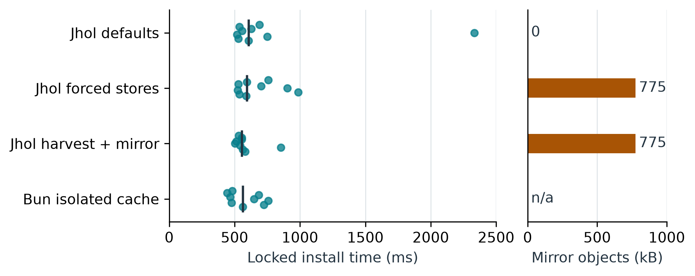

## Abstract {.unnumbered}

Secondary indexes can accelerate artifact lookup while increasing the storage and verification costs of package installation. We investigate this tradeoff in Jhol using JAGR-S, an optional memory-mapped mirror, and JGrid, a separate materialization store. We model the reuse volume needed to recover ingest and storage costs as a function of verified hit rate, hit benefit, and miss cost. In a nine-round locked-install ablation, the mirror-enabled arms wrote 775,006 bytes of mirror objects per run and produced no JGrid artifact. In a separate seeded probe, JAGR-S supplied 34 tarballs. An initial JGrid store missed replay because three package identities were incomplete. These observations establish that the experimental treatment and the storage route actually used must be reported separately. They provide no matched evidence for enabling the secondary stores by default.

# Introduction

I added secondary storage to Jhol to answer a practical question: how much work can an install skip if the machine already has the bytes? A tarball, an extracted package, and a ready project tree skip different parts of an install. A secondary store can remove work from one level while duplicating bytes or introducing publication work at another. This study asks when an optional store pays for itself in verified installation. It contributes a model of cumulative cost, a source audit of the index operations, and route-level evidence from a locked-install ablation and seeded probes.

# Background and Related Work

Dolstra's functional deployment model identifies build inputs and outputs through reproducible store paths [1]. Jhol's storage layers serve a different output model in which package instances are materialized in an existing mutable project. Swiss Tables accelerate search using grouped control-byte comparisons [2]. Elias's work establishes the lineage for representing and accessing monotone data [3]. The implementation audit distinguishes these techniques from the operations reached by the measured JAGR-S route. File-system persistence varies across platforms, so generation visibility and persistence of the underlying objects require distinct guarantees [4].

# System and Threat Model

Package resolution chooses an identity, source and expected integrity. Storage accepts bytes and materializes that choice. Each stage requires a distinct check.

| Layer | Reusable artifact | Evidence needed to accept a hit |
|:----------------------|:---------------------------|:--------------------------------------------|
| npm cache harvest | Compressed tarball | Expected SRI verified over compressed bytes |
| Primary Jhol store | Tarball and unpacked tree | Verified admission and an eligible complete extraction |
| JAGR-S mirror | Object and alias records | Validated lookup, expected identity and downstream integrity |
| JGrid | Blocks, package trees or bundle | Complete package identities and matching route and layout |
| Prepared project snapshot | Project-local tree | Bound inputs and verified lockfile layout, as in Paper III |

The primary store is the normal path. JAGR-S duplicates object storage only when enabled as a mirror. JGrid's runtime feature, ingest flags and replay eligibility are distinct. An enabled flag is an experimental treatment, while a verified route hit is an observed outcome. A failed optional lookup must fall back or fail explicitly under the mode's contract.

The trust boundary starts at the expected artifact identity and integrity. A cache may supply missing, corrupt, truncated or mismatched data. Archive extraction also has to enforce path confinement independently of an otherwise valid digest. The experiment assumes the manifest or lockfile and its registry identity are trusted inputs. A registry that deliberately publishes malicious content under its correct digest is outside the guarantee.

The October audit also identified a transfer boundary relevant to all these layers. The staged path downloads compressed bytes to a temporary file before extraction. The optional streamed extraction path overlaps transfer with projection while still recording compressed bytes. An SRI claim refers to the compressed artifact. A disk-write claim must account for both the archive and staged tree.

# Index Implementation

The examined implementation uses an mmap manifest with fixed-width entries and separate object and alias storage. Capacity and table extents are checked at open. The lookup in jagrs.rs scans slots individually, comparing the H2 fingerprint, entry kind and key hash. It is a scalar fingerprint probe in the audited route. The method named get_tarball_slice returns a Vec copied from the mapping. The Elias–Fano helper has an intra-word rank selection routine, while its sequence lookup walks high-bit words. Ordinary writes supply zero locality tags. These are distinct from the September manuscript's SIMD-group, borrowed slice, constant-time sequence lookup and deployed spectral-placement claims.

Open-time validation and collision handling serve different purposes. Validating the table's span proves that a slot address lies in the mapped table. Object extent, object size, identity and returned bytes must still be checked at the boundary where a hit is trusted. A truncated or malicious index must not turn a lookup miss into the wrong accepted artifact. The hash probe is an index accelerator. Expected cryptographic integrity remains the authorization for content reuse.

A generation counter can help readers detect change. Header flushing alone does not establish ordering, power-loss durability or cross-process exclusion for the object and alias logs. A proof for a durable design would have to specify file data persistence, publication order, synchronization with concurrent readers and writers, and safe reclamation. The unpacked-store marker records completed work. Jhol also rejects zero-length package manifests and marker-only trees. A marker or one body file cannot certify every descendant byte against arbitrary modification.

# Cost Model

Consider a fixed horizon and measure all time in the same units. Let $W$ be added ingest, indexing and verification time. Let $m$ be the number of eligible subsequent installs, $q$ the probability an eligible run reaches and verifies a mirror hit, $s$ the mean time saved conditional on that hit, and $c$ the mean penalty of trying a miss. Let $B$ be incremental bytes retained and $\lambda$ a workload-specific cost per retained byte over the chosen horizon. The net expected value in time-equivalent units is

$$
m\big(qs-(1-q)c\big)-W-\lambda B.
$$

The model assumes stationary per-attempt means over the stated horizon. When $g=qs-(1-q)c$ is positive, payback requires $m>(W+\lambda B)/g$. If $g$ is zero or negative, additional attempts do not repay a positive fixed cost under this policy. For a real workload, compute this per cache regime or sum the per-attempt estimates across regimes. Keep disk bytes and latency separate when no defensible conversion factor exists.

In a matched experiment, define $H_i=1$ only when the selected route actually yields a verified hit. Let $s_i$ be time saved on hit trials and $c_i$ time lost on miss trials, each measured against an equivalent control. With terms outside their relevant trial type set to zero, the empirical net gain per attempt is

$$
\widehat{g}=\frac{1}{n}\sum_{i=1}^{n}\bigl[H_i s_i-(1-H_i)c_i\bigr].
$$

This estimate requires route observations and a matched control. A flag alone supplies neither. A safe policy uses a conservative estimate of $g$. Charge bytes that duplicate the primary store and account for compaction, eviction, and background I/O. Compare total work as well as caller latency so deferral does not hide a regression. In a route with $q=0$ for JGrid, a faster end-to-end sample cannot establish a benefit from JGrid. This is directly testable from route traces and differs from extrapolating a probe microbenchmark to install latency.

# Evaluation Methodology

The first experiment asks which storage routes execute during a locked install. The five-root fixture is held fixed while secondary-store settings and cache eligibility vary. Nine interleaved runs per arm record elapsed time, realized package counts, import checks and persistent bytes. Route traces and artifact creation distinguish a store that was enabled from one that was used. The second experiment seeds identical artifacts for targeted replay probes. It checks whether the requested store supplies usable package bytes or falls back. The single seeded probes establish route behavior and do not estimate an effect size.

# Results

## Locked Install Ablation

| Locked install arm | Median [range], ms | JGrid bytes | Mirror bytes | Observed scope |
|:---------------------|:---------------------|-----------:|-------------:|:--------------------------|
| Jhol agent defaults | 606.6 [518.6, 2333.6] | 0 | 0 | Native locked route |
| Jhol forced secondary stores | 594.6 [523.9, 987.1] | 0 | 775006 | Mirror write, no JGrid artifact |
| Jhol harvest plus mirror | 554.9 [501.7, 853.8] | 0 | 775006 | Mirror write with harvest eligible |
| Bun isolated tool cache | 562.4 [444.0, 757.2] | — | — | Different resolved package count |

: Nine interleaved locked-install observations per arm.

The September fixture used five pinned roots, nine interleaved runs per arm, a lockfile, fresh Jhol cache directories and disabled daemon. All 27 Jhol samples passed the recorded root import checks. The archive reports 34 Jhol manifests and 31 for Bun throughout. Home-cache harvest remained eligible in relevant Jhol arms. The ranges and object sizes were recomputed from the archive. These rows are descriptive. The differing closures and route eligibility preclude attributing differences to JGrid or claiming a matched cold speedup over Bun. See the [ablation protocol and route traces](../architecture/experiments/jgrid-jagrs-ablation-2026-09-30.md) and [raw observations](../architecture/experiments/jgrid-jagrs-ablation-results.json).

{width=100%}

## Seeded Replay and Storage Costs

| Seeded or historical experiment | Observed result | What it establishes |
|:-------------------------|:-----------------------------------|:--------------------------------|
| Seed 34 packages | 4,296,518 B JGrid, 784,657 B mirror objects | Physical output for one seeded fixture |
| Original seeded JGrid replay | Normal fallback, no JGrid hit | Three empty name offsets prevented complete lookup |
| JAGR-S seeded replay | 34 tarballs materialized, three imports pass | Mirror can supply bytes on the normal install route |
| Clean offline JGrid replay | 304 ms profiler time, 34 manifests, five imports pass | One observed replay, no matched timing control |
| Earlier Next.js-scale warm measurements | About 128 MB extra for the mirror, 185 MB and 0.9 s for JGrid ingest | Historical storage cost with no established warm gain |

: Follow-up probes and separately recorded storage costs.

The first four rows come from the September follow-up probes. The final row is retained as a historical observation from the first edition. It lacks per-run provenance in the cited table and should not anchor a quantitative deployment threshold. The developer-cache harvest result of 44/70 is similarly conditioned on local cache contents. The September paper reported only 4/300 on the larger fixture. Future trials should vary cache density deliberately.

## Reuse Boundaries After Admission

A follow-up separated two checks that had been performed by different install routes. Prepared replay now shares a checker for package paths, names, versions and extra entries. This strengthens the acceptance rule for a prepared layout while leaving tarball admission tied to the expected compressed-byte digest. The release gate uses a disposable cache and compares two offline trees with a third after garbage collection. Injected failures verified that the gate rejects an empty tree, mismatched trees and a failed install or sweep. This gate test supplies no new measurement of JAGR-S or JGrid hit rate, disk cost or throughput.

# Threats to Validity

The compared package managers installed different closures. Home-cache harvest also remained eligible in some Jhol arms. These conditions prevent a matched inference about cold latency. The seeded probes covered one fixture, and the original Next.js-scale observations lack the per-run provenance needed for a new effect estimate. The isolated 1.8 ns and 3.4 ns observations from the initial manuscript require the original harness and precise exercised operations before they can support an implementation claim. Neither the archived runs nor the probes evaluate power-loss persistence.

# Conclusion

The first locked run taught me to ask which path ran before asking which setting was faster. Enabling JGrid produced no JGrid artifact on that path. The seeded probes gave a different answer about what the stores could do. Together, these runs make secondary storage a workload decision. A deployment decision needs observed verified hits, an equivalent primary-store control, and accounting for background work and persistent bytes. A follow-up should compare scalar and grouped probes across load factors and residency states, then measure the whole-install effect under fixed artifact sets and matched layouts.

# Artifact Availability {.unnumbered}

The [evidence script](../../scripts/bench/paper_evidence.py) reproduces the medians, ranges and scoped quality checks from the saved data. The linked ablation record describes flags, seeded probes and known fallback conditions. The [repository license](../../LICENSE) governs the software.

# References {.unnumbered}

1. E. Dolstra. *The Purely Functional Software Deployment Model*. PhD thesis, Utrecht University, 2006. [Thesis](https://nixos.org/~eelco/pubs/phd-thesis.pdf).
2. Abseil. “Swiss Tables Design Notes.” [Technical documentation](https://abseil.io/about/design/swisstables).
3. P. Elias. “Efficient Storage and Retrieval by Content and Address of Static Files.” *Journal of the ACM*, 21(2), 246–260, 1974. [DOI](https://doi.org/10.1145/321812.321820).
4. T. S. Pillai et al. “All File Systems Are Not Created Equal: On the Complexity of Crafting Crash-Consistent Applications.” *USENIX Symposium on Operating Systems Design and Implementation*, 2014. [Paper](https://www.usenix.org/conference/osdi14/technical-sessions/presentation/pillai).
